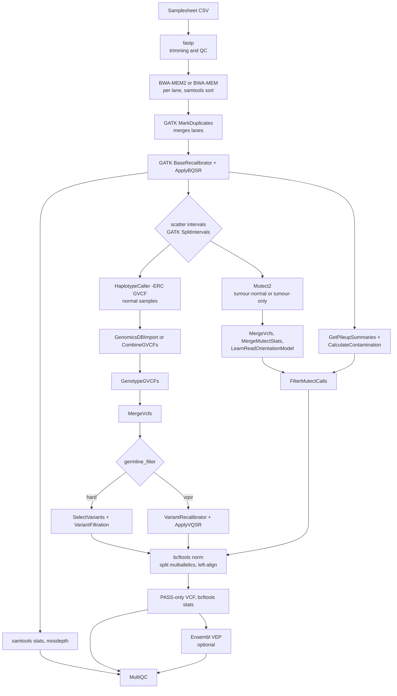

# ngs-automation-nextflow

[](https://github.com/bioinfosourabh/ngs-automation-nextflow/actions/workflows/ci.yml)
[](https://www.nextflow.io/)
[](LICENSE)

A Nextflow (DSL2) pipeline for germline and somatic short-variant calling (SNVs and indels) from paired-end Illumina FASTQ files. It follows the GATK4 best-practice workflows: read trimming, alignment, duplicate marking and base quality score recalibration; joint genotyping of germline samples; and Mutect2 calling of tumours, either against a matched normal or in tumour-only mode with a panel of normals and a population germline resource.

Every process runs in a pinned container (BioContainers or the Broad Institute GATK image), and the pipeline can be resumed with `-resume`.

## Workflow



## Quick start

1. Install [Nextflow](https://www.nextflow.io/docs/latest/install.html) (>= 24.10) and Docker, Singularity or Apptainer.
2. Run the bundled test data set (a synthetic two-contig genome with four simulated samples):

   ```bash
   nextflow run bioinfosourabh/ngs-automation-nextflow -profile test,docker --outdir results_test
   ```

3. Run your own data:

   ```bash
   nextflow run bioinfosourabh/ngs-automation-nextflow \
       -profile docker \
       --input samplesheet.csv \
       --outdir results \
       --fasta Homo_sapiens_assembly38.fasta \
       --dbsnp Homo_sapiens_assembly38.dbsnp138.vcf.gz \
       --known_indels Mills_and_1000G_gold_standard.indels.hg38.vcf.gz,Homo_sapiens_assembly38.known_indels.vcf.gz \
       --germline_resource af-only-gnomad.hg38.vcf.gz \
       --pon 1000g_pon.hg38.vcf.gz \
       --contamination_variants small_exac_common_3.hg38.vcf.gz \
       --intervals exome_targets.bed --interval_padding 100
   ```

   Leave out `--intervals` for whole-genome data. All of the resource files above are in the GATK resource bundle for GRCh38.

## Input

A CSV samplesheet with one row per sample and sequencing lane:

```csv
patient,sample,status,lane,fastq_1,fastq_2
P1,P1_N,0,L001,/data/P1_N_L001_R1.fastq.gz,/data/P1_N_L001_R2.fastq.gz
P1,P1_N,0,L002,/data/P1_N_L002_R1.fastq.gz,/data/P1_N_L002_R2.fastq.gz
P1,P1_T,1,L001,/data/P1_T_L001_R1.fastq.gz,/data/P1_T_L001_R2.fastq.gz
P2,P2_T,1,L001,/data/P2_T_L001_R1.fastq.gz,/data/P2_T_L001_R2.fastq.gz
```

- `status` is `0` for a normal (germline) sample and `1` for a tumour. Normals are jointly genotyped; each tumour is called against its patient's normal, or in tumour-only mode if the patient has no normal (P2 above).
- Lanes of the same sample are aligned separately with their own read groups and merged at duplicate marking.
- The samplesheet is validated before anything runs (required columns, file existence, unique sample/lane pairs, one normal per patient).

See [docs/usage.md](docs/usage.md) for all options.

## Output

```
results/
├── preprocessing/        fastp reports, duplicate metrics, BQSR tables, recalibrated BAMs
├── qc/                   samtools stats/flagstat, mosdepth, bcftools stats
├── variant_calling/
│   ├── germline/joint_germline/   raw, filtered and PASS joint-called VCFs
│   └── somatic/<tumour>_vs_<normal>/ or <tumour>_tumour_only/
├── annotation/           VEP-annotated VCFs (with --run_vep)
├── multiqc/              multiqc_report.html
└── pipeline_info/        execution report, timeline, trace, DAG, software_versions.yml
```

[docs/output.md](docs/output.md) describes each file.

## Main parameters

| Parameter | Default | Description |
|---|---|---|
| `--input` | | samplesheet CSV |
| `--outdir` | | output directory |
| `--fasta` | | reference FASTA; `.fai`, `.dict` and aligner index are built if not given |
| `--intervals` | none | target BED for exome/panel data |
| `--aligner` | `bwa-mem2` | `bwa-mem2` or `bwa` |
| `--scatter_count` | 8 | interval chunks for parallel calling |
| `--dbsnp`, `--known_indels` | | known sites for BQSR |
| `--run_germline` | true | joint genotyping of normal samples |
| `--joint_caller` | `genomicsdb` | `genomicsdb` or `combinegvcfs` |
| `--germline_filter` | `hard` | `hard` (GATK generic thresholds) or `vqsr` |
| `--run_somatic` | true | Mutect2 on tumour samples |
| `--germline_resource`, `--pon` | | Mutect2 population resource and panel of normals |
| `--contamination_variants` | none | common SNPs for contamination estimation |
| `--run_vep` | false | annotate PASS calls with Ensembl VEP (needs `--vep_cache`) |

All parameters are listed in [nextflow_schema.json](nextflow_schema.json). Unknown parameters produce a warning and invalid values stop the run before any job starts.

## Profiles

| Profile | Use |
|---|---|
| `docker`, `singularity`, `apptainer` | container engine |
| `test` | bundled synthetic data |
| `awsbatch` | run on AWS Batch (`--awsqueue`, `--awsregion`, and `-work-dir s3://...`); see [aws-genomics-workflow](https://github.com/bioinfosourabh/aws-genomics-workflow) |

Resource requests are in [conf/base.config](conf/base.config) and are capped by `process.resourceLimits`; override them for your system with `-c custom.config`.

## Testing

- CI runs `nextflow lint` and stub runs (`-stub-run`) of the test profile with four parameter sets (default, alternative aligner and joint caller, VQSR + VEP, whole-genome mode without PoN or contamination). Stub runs check the channel logic, file naming and parameter handling, not the tools.
- The test data are produced by [tests/make_test_data.py](tests/make_test_data.py) and include truth tables for the simulated variants. On a real run of the test profile outside containers (samtools/bcftools 1.21, BWA-MEM2 2.2.1, GATK 4.6.1.0, fastp 0.20.1, mosdepth 0.3.10, with `--joint_caller combinegvcfs`), the germline calls matched all simulated germline variants of both normals (two indels differ only by left-alignment) and Mutect2 recovered 7 of 8 somatic SNVs in the tumour-normal pair and 6 of 6 in the tumour-only sample, with no false positives.

## Tools

| Step | Tool | Reference |
|---|---|---|
| Trimming, read QC | fastp 0.23.4 | Chen et al. 2018, *Bioinformatics* 34:i884 |
| Alignment | BWA-MEM2 2.2.1 / BWA 0.7.18 | Vasimuddin et al. 2019, IPDPS; Li 2013, arXiv:1303.3997 |
| BAM handling, stats | samtools | Danecek et al. 2021, *GigaScience* 10:giab008 |
| Duplicates, BQSR, calling, filtering | GATK 4.6.1.0 | Van der Auwera & O'Connor 2020, *Genomics in the Cloud* (O'Reilly); Poplin et al. 2018, bioRxiv 201178 |
| Normalisation, stats | bcftools 1.20 | Danecek et al. 2021, *GigaScience* 10:giab008 |
| Coverage | mosdepth 0.3.10 | Pedersen & Quinlan 2018, *Bioinformatics* 34:867 |
| Annotation | Ensembl VEP 114 | McLaren et al. 2016, *Genome Biology* 17:122 |
| Report | MultiQC 1.30 | Ewels et al. 2016, *Bioinformatics* 32:3047 |
| Workflow manager | Nextflow | Di Tommaso et al. 2017, *Nature Biotechnology* 35:316 |

## Limitations

- Short variants only. Copy-number and structural variants are not called (see [cnv-controlfreec-batch](https://github.com/bioinfosourabh/cnv-controlfreec-batch) for CNVs).
- Input is FASTQ; starting from BAM/CRAM is not supported yet.
- VQSR needs a large call set (roughly 30 or more exomes, or whole genomes) to train; for smaller cohorts use the default hard filters.
- Tumour-only Mutect2 calls contain residual germline variants even with a germline resource and PoN; interpret them accordingly.
- Contamination estimation is skipped unless `--contamination_variants` is given.
- The GenomicsDB route has been exercised in stub runs and up to GenomicsDBImport in a real run; GenotypeGVCFs on the GenomicsDB workspace could not be run outside the GATK container in the development environment, so the CombineGVCFs route was used for the real test run.

## License

MIT, see [LICENSE](LICENSE).

## Author

Sourabh Kumar · bioinfosourabh@gmail.com · https://bioinfosourabh.netlify.app · ORCID https://orcid.org/0009-0009-5840-9830
